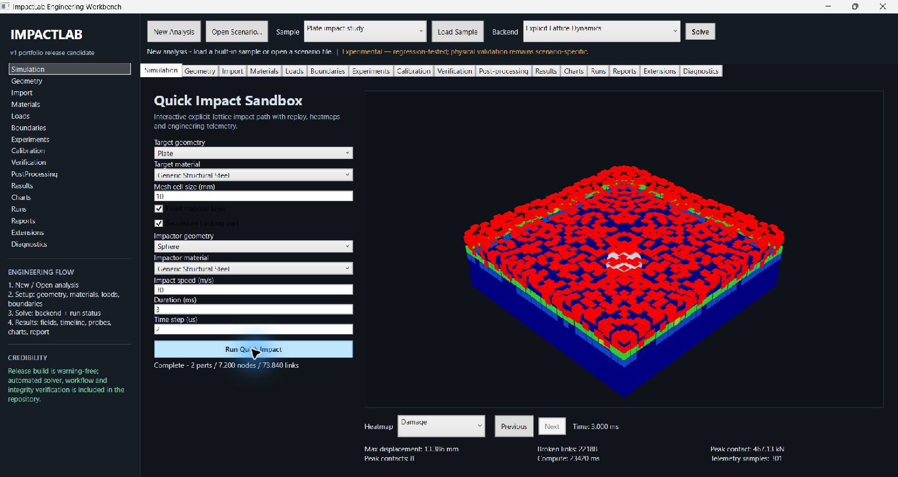

<p align="center">
  
</p>

# ImpactLab

[English](README.md)

[İlk kullanım ve sorun giderme](docs/GETTING_STARTED.md) · [Son yerel doğrulama](docs/REVIEW_2026-10-10.md)

Kaynak derleme/test: `powershell -NoProfile -File tools/check.ps1`.
Taşınabilir önizleme ZIP'i üretme: `powershell -NoProfile -File tools/package.ps1`.
Paketler imzasız önizlemedir; temiz bilgisayarda kurulum doğrulaması yapılmış sayılmaz.

**Darbe simülasyonu, continuum mechanics, termal bağlaşım, deneyler ve tekrarlanabilir doğrulama için yerel bir Windows mühendislik çalışma ortamı.**

ImpactLab, bir mühendislik senaryosunu izlenebilir bir akışa dönüştürür: geometri ve malzemeleri tanımlama, yük ve sınır koşullarını uygulama, sayısal backend seçme, çözme, alanları ve probe’ları inceleme, deneyleri karşılaştırma ve deterministik rapor paketi üretme. Masaüstü kabuğu WPF’tir; sayısal ve iş akışı katmanları yeniden kullanılabilir .NET kütüphanelerine ve yalıtılmış worker process’lerine ayrılmıştır.

> Lise yıllarımda başladığım kişisel bir mühendislik projesi. Sertifikalı bir FEA ürünü veya doğrulanmış ticari solver’ların yerine geçen bir araç olarak değil, deneysel bir çalışma ortamı ve öğrenme platformu olarak yayımlanıyor.



*Gerçek Release-build görüntüsü: tamamlanmış bir Quick Impact Sandbox çalışmasının 3B sonuç görünümü. Görüntü fiziksel doğruluk kanıtı değildir.*

## Mühendislik açısından içeriği

- Birden fazla analiz yolu: explicit lattice impact, linear-static tetrahedral continuum, transient dynamics, nonlinear/finite-strain temelleri ve thermo-mechanical coupling.
- UI mock-up’ının ötesinde mekanik bileşenler: sparse CSR matrisler, iterative solver’lar, tetrahedral assembly, J2 plasticity, Neo-Hookean malzeme cevabı, penalty/friction contact ve enerji tanıları.
- Senaryo migration, mesh import/repair, parameter sweep, uncertainty ve optimization araçları, result streaming, probe, chart, report ve run archive içeren ürün yüzeyi.
- Deney worker’ları ve güvenilmeyen extension’lar için sürümlenmiş IPC sözleşmeleriyle process sınırları; açık güven ve uyumluluk kuralları.
- Mimariye dâhil edilmiş doğrulama: analitik benchmark’lar, referans sinyal karşılaştırması, şema migration testleri, deterministik rapor kontrolleri, bütünlük denetimleri ve CI kanıt dosyaları.
- Taşınabilir `.impactlab` proje paketleri senaryoyu, kullanıcı malzemelerini ve içe alınmış STL/OBJ varlıklarını tek dosyada saklar.
- Sade masaüstü arayüzü yinelenen sekme şeridi yerine tek navigasyon alanı, kompakt komut çubuğu, tutarlı mühendislik kontrolleri ve hızlı darbe/assembly/proje/örnek başlangıçlarını sunan bir Start çalışma alanı kullanır.
- **Assembly** çalışma alanı birden fazla STL/OBJ dosyasını tek mesh’e ezmeden izlenebilir parçalar halinde birleştirir; her parça rolünü, malzemesini, katman sırasını, kaynak birimini, ötelemesini, dönüşünü, ölçeğini ve başlangıç hızını korur. İçe alınmış mesh hem deforme olan hedef hem hareketli rijit çarpan olabilir.
- Tamamlanmış koşular, her karenin fiziksel zamanını taşıyan JSON zaman çizelgesiyle birlikte animasyonlu GIF olarak veya FFmpeg bulunduğunda H.264 MP4 olarak dışa aktarılabilir.
- Malzeme kütüphanesi; 15 adlandırılmış mühendislik sınıfı/alaşımı/polimer/seramik yanında kullanıcı tanımlı malzemeleri, nominal akma/çekme dayanımlarını ve standart bilgisini destekler.
- STL yüzeyleri eksen boyunca katmanlara ayrılıp yeniden STL olarak yazılabilir; ayrıntılı CSV çıktısı düğüm bazında deplasman, hız, hasar, eşdeğer şekil değiştirme, yaklaşık eşdeğer gerilme ve akma emniyet katsayısı üretir.
- Her koşu; zaman adımı, enerji dengesi, temas penetrasyonu, malzeme izlenebilirliği, sonlu sayısal durum ve kaba mesh çözünürlüğü için otomatik geçerlilik taramasından geçer.
- Genel amaçlı **Mobility** çalışma alanı araç ve arazi verilerinden geçilebilirlik, risk nedenleri ve rota maliyeti üretir; engelli hücreleri dolaşan A* planlayıcı ile TensorFlow uyumlu CSV/şema dışa aktarımı içerir.

## Çalışma ortamı nasıl kuruldu?

Senaryo, ürün arayüzü ile sayısal kodu birleştiren temel birimdir. WPF
uygulaması geometri, malzeme, yük, sınır koşulu ve backend ayarlarını toplar;
sürümlenmiş senaryo verisi ve migration’lar kayıtlı girdilerin okunmasını
sağlar. Seçilen backend `ImpactLab.Core` üzerinden çalışır; masaüstü arayüzü
ortaya çıkan alanları, telemetriyi, probe’ları, chart’ları ve rapor/export
akışlarını sunar.

Uygulama, farklı hata ve güven profilleri olan işleri ayırır. Sayısal ve
domain kodu yeniden kullanılabilir bir kütüphanededir; parameter study’ler
yalıtılmış worker’da çalışabilir; extension’lar ayrı host ve açık uyumluluk/
güven kuralları kullanır. Analitik/referans testleri, şema fixture’ları ve
bütünlük denetimleri bu parçaları ayrı ayrı sınar. Bunlar yazılım davranışı
ve regresyon kanıtıdır; ölçülmemiş gerçek bir darbenin fiziksel doğruluğu
anlamına gelmez.

## Doğrulanmış durum

Mevcut Windows release adayı .NET 8 ile; analyzer’lar ve warnings-as-errors açıkken kaynaktan yeniden build edildi.

| Kapı | Sonuç |
| --- | --- |
| Release solution build | **Geçti — 0 uyarı, 0 hata** |
| xUnit testleri | **Geçti — 111/111** |
| Kaynak biçimi | **Geçti — 1.171 dosya kontrol edildi** |
| Taşınabilir bütünlük denetimleri | **Geçti — 6/6** |
| WPF açılış smoke testi | **Geçti — process 8 saniye sağlıklı kaldı** |
| Etkileşimli Quick Impact | **Release uygulamasında tamamlandı — 3,000 ms simülasyon, 235 ms hesaplama, 31 telemetry örneği** |
| Yerleşik senaryo UI akışı | **Plate impact study: Load Sample → Solve → Results Explorer, Release uygulamasında tamamlandı** |
| Birlikte build edilen projeler | Core, WPF App, Worker, ExtensionHost, Extractor, MeshAdapter sample, Tests |
| GitHub Actions | **Geçti** — Windows bütünlük denetimleri, biçim kontrolü, Release build ve testler [yayımlanmış workflow koşusunda](https://github.com/AkifAydemir/ImpactLab/actions/runs/35299671087) tamamlandı |

Komutlar ve iddia sınırları için [doğrulama ayrıntılarına](docs/VALIDATION.md) bakın. Sonraki push’ların durumunu [güncel koşulardan](https://github.com/AkifAydemir/ImpactLab/actions) kontrol edin. Güncel masaüstü paket sürümü: **1.0.0**.

Genişletilebilir çok-modelli çözücü yönü ve doğruluk kuralları
[fizik motoru mimarisi](docs/PHYSICS_ENGINE_ARCHITECTURE.md) belgesinde kayıtlıdır.

## Kısa mimari görünüm

```text
WPF workbench
  ├─ scenario authoring and schema migration
  ├─ geometry, materials, loads, boundaries
  ├─ solve orchestration and backend registry
  └─ results, probes, charts, reports, archives
                    │
                    ▼
               ImpactLab.Core
  ├─ lattice + tetrahedral continuum mechanics
  ├─ contact + constitutive laws + thermal coupling
  ├─ sparse solvers + numerical diagnostics
  └─ experiments + verification + persistence
          │                         │
          ▼                         ▼
 isolated experiment worker    isolated extension host
```

Daha ayrıntılı bağımlılık ve veri akışı için [mimari notlarına](docs/ARCHITECTURE.md) bakın.

## Bir senaryonun sistem içindeki yolu

Senaryo, yalnızca arayüzde tutulan durum yerine sürümlenmiş girdi olarak
başlar. Yüklendiğinde veya oluşturulduğunda geometri, malzemeler, seçimler,
yükler, kısıtlar, probe’lar, rigid body’ler ve contact kuralları
`ScenarioCompiler`’a geçer. Compiler, `SimulationBackendRegistry` istenen
analiz yolunu seçmeden önce bu girdileri çözümler ve denetler. Bu ayrım,
WPF kabuğunun etkileşimi yönetmesini, sayısal denklemlerin ise view veya
view model içine gömülmemesini sağlar.

Backend; uyumluluk için sonuç verisini, türlendirilmiş result domain’i ve
uygunsa native continuum sonucunu taşıyan immutable bir `BackendRunOutput`
döndürür. Adapter’lar frame, alan, telemetri, tanı, probe, chart, arşiv ve
deterministik raporları ilgili çalışma alanına sunar. Aynı sonuç sınırı hem
hızlı lattice gösterimini hem daha zengin continuum tüketicilerini destekler;
her backend’in aynı alanları ürettiği varsayılmaz. Yerleşik Plate impact
study’nin Results Explorer’a ulaştığı gözlendi; bu uygulama akışının kanıtıdır,
doğrulanmış darbe tahmini değildir.

Uzun süren veya daha az güvenilen işler WPF UI thread’inin içine gizlenmez.
Experiment vakaları, heartbeat, sınırlandırılmış eşzamanlılık ve hash’lenmiş
artifact’ları olan sürümlenmiş worker protokolünden geçebilir. Process içinde
çalışması için güvenilmeyen extension’lar ayrı host ve açık uyumluluk/güven
kontrolleri kullanır. Sürümlenmiş belge migration’ları ve rapor fixture’ları
eski girdileri ve üretilen çıktıları test edilebilir tutar. 111 test ve altı
bütünlük denetimi bu sözleşmelerin çoğunu kapsar; fiziksel doğrulama içinse
yakınsama, malzeme kalibrasyonu ve bağımsız ölçümlerle karşılaştırma gerekir.

### Kodu nereden okumalı?

| Dosya | İncelenecek konu |
| --- | --- |
| [`src/ImpactLab.Core/Scenarios/ScenarioCompiler.cs`](src/ImpactLab.Core/Scenarios/ScenarioCompiler.cs) | Senaryo denetimi ve çözülmüş solver girdileri. |
| [`src/ImpactLab.Core/Backends/SimulationBackendRegistry.cs`](src/ImpactLab.Core/Backends/SimulationBackendRegistry.cs) | Backend seçimi sınırı. |
| [`src/ImpactLab.Core/Backends/BackendRunOutput.cs`](src/ImpactLab.Core/Backends/BackendRunOutput.cs) | Ortak immutable koşu sonucu sözleşmesi. |
| [`src/ImpactLab.App/Services/SimulationRunnerService.cs`](src/ImpactLab.App/Services/SimulationRunnerService.cs) | UI ile solver arasındaki orkestrasyon. |
| [`src/ImpactLab.Worker/WorkerHost.cs`](src/ImpactLab.Worker/WorkerHost.cs) | Yalıtılmış deney yürütme. |
| [`src/ImpactLab.ExtensionHost/ExtensionHostRuntime.cs`](src/ImpactLab.ExtensionHost/ExtensionHostRuntime.cs) | Ayrı process’te extension runtime’ı. |
| [`eng/verify.ps1`](eng/verify.ps1) | Tekrarlanabilir Windows doğrulama sırası. |

## Doğrulanmış etkileşimli başlangıç

1. Windows Release uygulamasında **Simulation → Quick Impact Sandbox** bölümünü açın.
2. Başlangıç için **Mesh cell size** değerini `20 mm`, **Time step** değerini `1.5 µs` yapın; koşu raporundaki explicit time-step kapısını kontrol edin.
3. **Run Quick Impact** seçeneğini çalıştırın. Yukarıdaki gerçek yakalamada 3B sahne ve 31 telemetry örneği oluştu.

İkinci bir UI akışı için yerleşik **Plate impact study** örneğini seçin, **Explicit Lattice Dynamics** backend’ini koruyun ve **Solve** seçeneğine basın. Release uygulaması bu kaba çözünürlüklü örneği tamamlayıp `15` numaralı karede **Results Explorer** bölümünü açtı. Bu gözlem iş akışı geçişini ve sonuç satırlarının oluşmasını doğrular; anlamlı bir darbe cevabı veya fiziksel doğruluk iddiası taşımaz. Daha açıklayıcı ürün görüntüsü yukarıdaki Quick Impact ekranıdır.

## Hızlı başlangıç

Gereksinimler: Windows 10/11 ve .NET 8 SDK.

```powershell
dotnet restore .\ImpactLab.sln
dotnet build .\ImpactLab.sln -c Release --no-restore
dotnet test .\ImpactLab.sln -c Release --no-build
dotnet run --project .\src\ImpactLab.App\ImpactLab.App.csproj -c Release
```

Repo’nun kanıt üreten doğrulama yolu:

```powershell
dotnet tool restore
dotnet tool run csharpier check .
.\eng\verify.ps1
```

Kısa canlı demo için yukarıdaki doğrulanmış Quick Impact yolunu kullanın. Yerleşik senaryo akışı ve sınırları [doğrulama ayrıntılarında](docs/VALIDATION.md) kayıtlıdır.

## Repo yapısı

| Yol | Görev |
| --- | --- |
| `src/ImpactLab.Core` | Sayısal çekirdekler, domain modelleri, backend’ler, deneyler, sonuçlar, persistence, doğrulama |
| `src/ImpactLab.App` | Windows/WPF mühendislik çalışma ortamı |
| `src/ImpactLab.Worker` | Yalıtılmış parameter-study yürütmesi |
| `src/ImpactLab.ExtensionHost` | Process dışı extension sınırı |
| `tests/ImpactLab.Core.Tests` | Birim, sayısal sözleşme, güvenlik, migration ve iş akışı testleri |
| `eng` | Release doğrulaması ve taşınabilir bütünlük denetimleri |
| `samples` | Senaryo, mesher sözleşmesi, erişilebilirlik, extension-policy ve rapor örnekleri |
| `docs` | Güncel mimari/doğrulama notları ve sürümlenmiş tasarım geçmişi |

Küçük ve incelenebilir değişiklikler için yerel kalite kapıları [CONTRIBUTING.md](CONTRIBUTING.md) dosyasında yer alır.

## Kapsam ve sınırlamalar

ImpactLab yazılım mimarisi ve sayısal mühendislik pratiğini gösterir. Geçen testler, uygulanan sözleşmelerin ve dâhil edilen analitik/referans vakaların beklenen şekilde davrandığını gösterir; rastgele gerçek yapıların davranışını öngörme doğruluğunu **kanıtlamaz**. Üretim kullanımında mesh/time-step yakınsama çalışmaları, deneysel korelasyon, daha geniş eleman ve contact doğrulaması, malzeme kalibrasyonu ve bağımsız inceleme gerekir.

Bu sınır bilinçlidir: proje varsayımları ve kanıtı etkileyici ekran görüntülerinin arkasına saklamamayı amaçlar.

STL katman dışa aktarımı üçgenleri merkez noktalarına göre yüzey gruplarına ayırır; kesme düzleminden geçen üçgenleri geometrik olarak bölüp kapalı hacimler üretmez. Assembly içe aktarımı bağımsız parçaları ve temas kimliğini korur; CAD boolean union işlemi değildir. Continuum analizi öncesinde watertight/hacimsel geometri, parça hizası, temas çiftleri, mesh yakınsaması ve açık zaman adımı ayrıca doğrulanmalıdır. Yerleşik malzeme değerleri nominal oda sıcaklığı referanslarıdır; gerçek parça için üretici veri sayfası veya test sertifikasıyla değiştirilmelidir. GIF çıktısı kayıtlı çözücü karelerinin mühendislik görselleştirmesidir; ek fiziksel kanıt sayılmaz.

## Lisans

[MIT Lisansı](LICENSE) altında yayımlanır.
